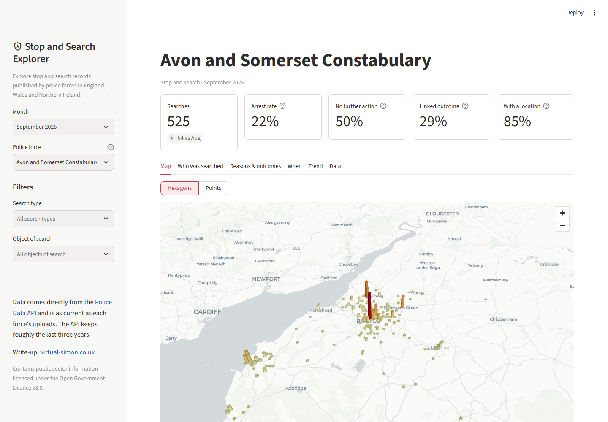
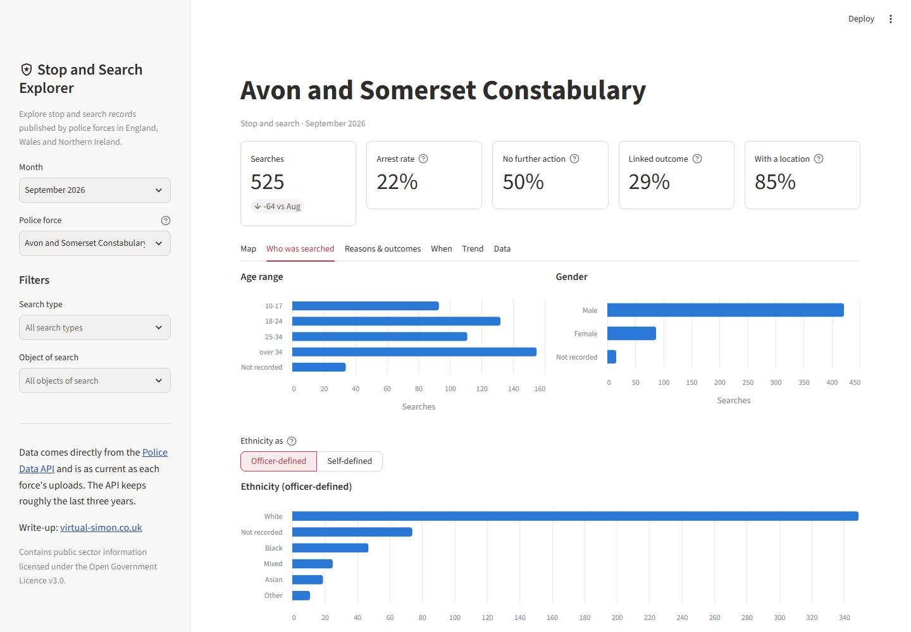
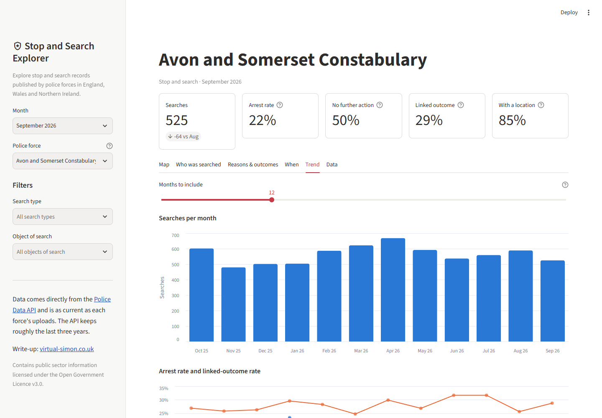
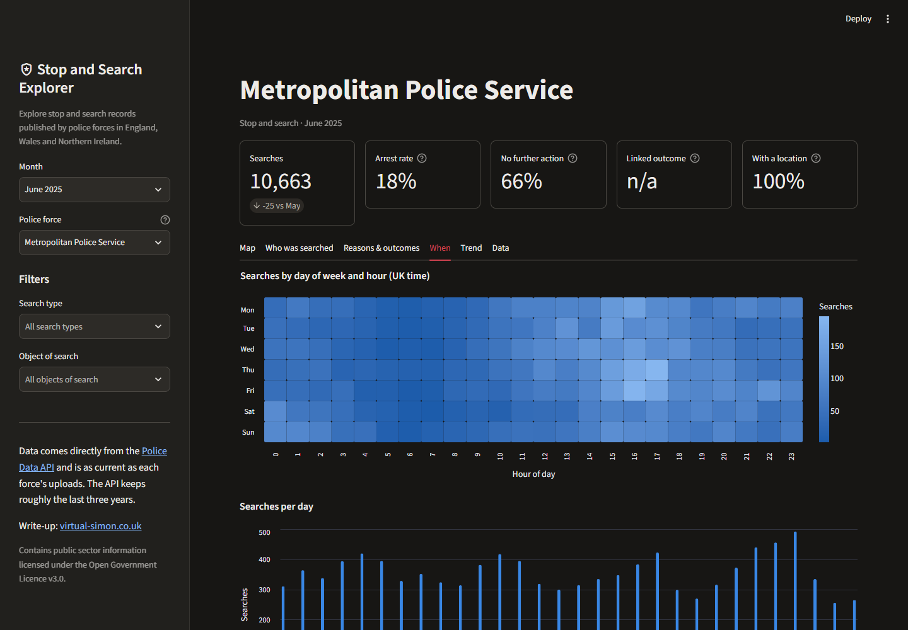

# Streamlit-PoliceStopandSearch-UK

A [Streamlit](https://streamlit.io/) app for exploring UK police stop and search records, using the
[Police Data API](https://data.police.uk/docs/).

**Live app:** https://policestopandsearch-uk.streamlit.app/

Created by [Simon Conyard](https://www.linkedin.com/in/simonconyard/).



## What it does

Pick a **month** and a **police force** in the sidebar. The app loads every stop and search record that force
published for that month and shows:

- **Headline figures:** total searches (with the change on the previous month), arrest rate, no further action
  rate, linked-outcome rate, and how many records include a location.
- **Map:** 3D hexagon density or individual points, centred on the force area. Hover for details.
- **Who was searched:** age range, gender and ethnicity (officer-defined or self-defined), plus what people were
  searched for by age range.
- **Reasons & outcomes:** object of search, outcome, outcome by object of search, legislation and search type.
- **When:** a day-of-week × hour-of-day heatmap and searches per day.
- **Trend:** up to 36 months for the force: searches per month, arrest and linked-outcome rates, and searches by
  object of search.
- **Data:** the full table, downloadable as CSV, with a link to the underlying API query.

Filters for search type and object of search apply to every view. The month, force and open tab are kept in the
URL, so you can share a link to a specific view.





## How it works

- `forces` gives the list of forces and their names.
- `crimes-street-dates` lists which months are available, and which forces published stop and search data for
  each month. Only valid combinations are offered, so you don't hit "no data" errors.
- `stops-force?force=<id>&date=<YYYY-MM>` returns the records, which are flattened into a pandas DataFrame.

API responses are cached for 24 hours, so moving between views and filters doesn't re-query the API. Most forces
load in a second or two, but the API can take 30 seconds or more to prepare a month for the largest forces (the Met
especially). The app shows a note and a timer while it waits, loads the Trend tab's months in parallel with a
progress bar and time estimate, and fills in the month-on-month comparison after the rest of the page has loaded. Charts
use Altair, and the map uses pydeck with Streamlit's theme-aware base map. Light and dark themes are both
supported.

### Notes on the data

- The API holds roughly the last three years. Recent months may not include every force yet, because uploads lag.
- Locations are approximate: the API snaps each location to an anonymised nearby point. Some records have no
  location at all.
- *Linked outcome* is the share of searches where the outcome was linked to the object of search. Some forces don't
  record this field reliably (for example, everything is recorded as "not linked", even arrests). For those forces the
  app shows **n/a** rather than a misleading figure.
- The ethnicity and age charts are counts only. Comparing groups fairly needs local population figures, which aren't
  part of this data.



## Running locally

```bash
python -m venv .venv
.venv/Scripts/activate        # Windows; use `source .venv/bin/activate` on macOS/Linux
pip install -r requirements.txt
streamlit run app.py
```

Requires Python 3.11 or later.

## Deployment

The app is hosted on [Streamlit Community Cloud](https://streamlit.io/cloud), which deploys straight from this
repository's `main` branch: pushing to `main` updates the live app. Community Cloud builds the environment from
`requirements.txt` (no Docker needed). The Python version is set in the app's *Advanced settings* on Community Cloud.

## Support

No support offered or liability accepted. Use is entirely at your own risk.

Contains public sector information licensed under the Open Government Licence v3.0.
